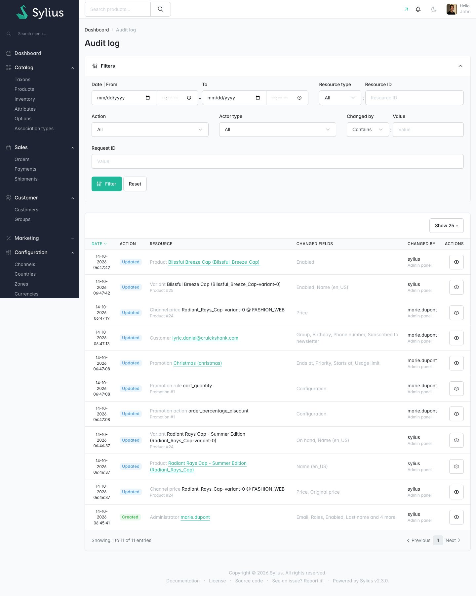
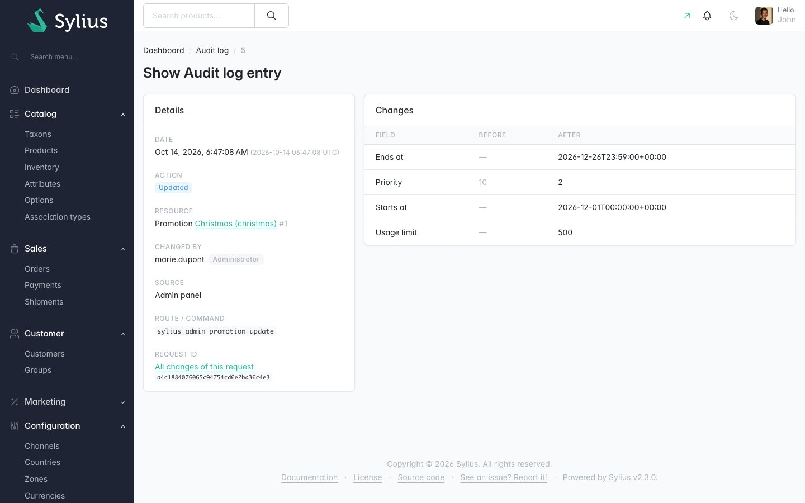
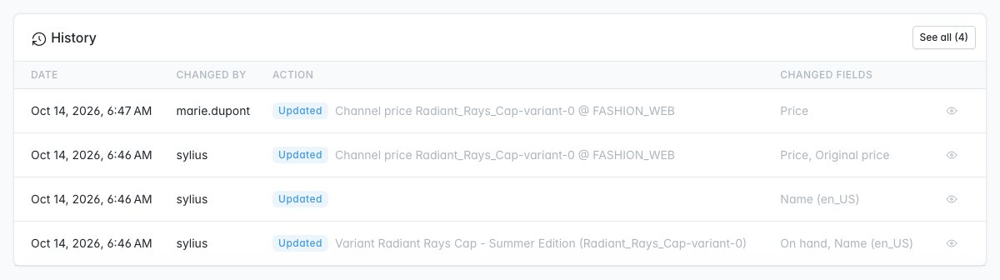

# Sylius Audit Log Plugin

> Français : [README.fr.md](README.fr.md) <!-- vitrine:lang -->

[](https://github.com/thibmonier/sylius-audit-log-plugin/actions/workflows/build.yaml)
[](LICENSE)

**Who changed what, when: an audit log of the changes made in the Sylius 2 back office.**

A price dropped, a promotion started a day early, a product disappeared from a channel: the
Sylius 2 admin cannot tell who did it. The audit plugins written for Sylius 1 were never
ported.

This plugin records the creations, updates and deletions of the main Sylius resources with a
field-level diff (old → new), the administrator who made them and the request they came from,
and shows them in the admin. It is free and open source.

## Features

| Need | What the plugin does |
|---|---|
| Know who changed a resource, and how | Every create / update / delete of the audited resources is recorded with a **field-level diff** (old → new), the date (UTC), the **actor** (administrator id + username snapshot, customer, command line or system), the **source** (admin panel, admin API, shop, shop API, command line) and the route or console command. |
| Search the trail | **Configuration › Audit log** page: a Sylius grid filtered by date range, resource (type and id), action, actor and actor type, request. Each entry has a page with a readable diff table. |
| See the history where you work | **History card** on the product (show and edit), order, customer and promotion pages: the last changes of the resource and of what it owns (variants, prices, coupons, payments, addresses...), with a link to the filtered grid. |
| Group the changes of one save | Every entry carries a **request id** (`X-Request-Id` header when present): "All changes of this request" lists everything one click changed. |
| Keep secrets out of the log | Passwords, salts, tokens, payment details and gateway configuration are **masked**: the log says that they changed, never their values. Long texts are **truncated**. |
| Respect the GDPR | **Retention**: `tmonier:audit-log:purge` deletes entries older than `retention_days` (365 by default). **Erasure**: `tmonier:audit-log:anonymize-customer` removes a customer's personal data from the trail. IP addresses are not stored by default (anonymised when enabled). |
| Audit your own entities | Add any Doctrine entity to the configuration; tag your own label or owner resolvers; listen to an event to enrich or skip entries. |

Also included: translations in English, French, German, Spanish, Italian, Dutch and Polish;
Twig Hooks everywhere; MySQL, MariaDB and PostgreSQL support.

### Audit log or timeline?

This plugin is a **technical** audit trail of the data changed in the back office, for every
resource. The sibling plugin [tmonier/sylius-timeline-plugin](https://github.com/thibmonier/sylius-timeline-plugin)
is a **business** view of an order's life (placed, paid, shipped, e-mails sent) with internal
staff notes. They complement each other and can be installed together.

## Screenshots







## Requirements

| | Version |
|---|---|
| PHP | 8.2+ |
| Sylius | 2.2, 2.3 |
| Symfony | 6.4, 7.4, 8.0 |

## Installation

1. Require the package:

    ```bash
    composer require tmonier/sylius-audit-log-plugin
    ```

2. Register the bundle in `config/bundles.php` (Symfony Flex does it automatically once a recipe exists):

    ```php
    Tmonier\SyliusAuditLogPlugin\TmonierSyliusAuditLogPlugin::class => ['all' => true],
    ```

3. Import the configuration in `config/packages/tmonier_sylius_audit_log.yaml`:

    ```yaml
    imports:
        - { resource: "@TmonierSyliusAuditLogPlugin/config/config.yaml" }
    ```

4. Import the admin routes in `config/routes/tmonier_sylius_audit_log.yaml`:

    ```yaml
    tmonier_sylius_audit_log:
        resource: "@TmonierSyliusAuditLogPlugin/config/routes.yaml"
    ```

5. Run the migrations:

    ```bash
    bin/console doctrine:migrations:migrate
    ```

6. Schedule the purge (cron, Symfony Scheduler...), for instance daily:

    ```bash
    bin/console tmonier:audit-log:purge
    ```

## Configuration

Every key is optional; the defaults are shown.

```yaml
# config/packages/tmonier_sylius_audit_log.yaml
tmonier_sylius_audit_log:
    enabled: true                 # false: record nothing (the admin pages stay available)
    sources: [admin, admin_api, cli]   # also: shop, shop_api, other
    ignored_commands: [sylius:fixtures:load, doctrine:fixtures:load]

    # Merged with the default resources (see below). A resource is a Doctrine class or interface.
    resources:
        tax_category:                                   # add one
            class: Sylius\Component\Taxation\Model\TaxCategoryInterface
        brand:                                          # add one owned by another resource
            class: App\Entity\Brand
            owner: product                              # its entries show on the product history
            owner_property_path: product
        product:
            ignored_fields: [position]                  # extra ignored fields for one resource
        customer: false                                 # stop auditing a default resource

    ignored_fields: [createdAt, updatedAt, lastLogin, emailCanonical, usernameCanonical, version]
    masked_fields: [password, plainPassword, salt, tokenValue, details, config]
    masked_field_patterns: ['/password/i', '/secret/i', '/token/i', '/salt/i', '/credential/i', '/api_?key/i']
    max_value_length: 500         # longer texts are truncated with "…"

    store_ip: false
    anonymize_ip: true            # 203.0.113.42 -> 203.0.113.0 when store_ip is on

    retention_days: 365           # default of tmonier:audit-log:purge; null keeps entries forever
    personal_resources: [customer, address]           # fully anonymised on erasure
    personal_fields: [email, firstName, lastName, phoneNumber, street, city, postcode, customer, notes, ...]

    history_limit: 10             # entries shown in the history cards
```

### Audited by default

| Resource | Owner (history card) |
|---|---|
| Products (with their translations) | — |
| Variants (incl. stock `onHand` / `onHold`), channel prices | product |
| Taxons | — |
| Promotions; their coupons, rules and actions | promotion |
| Catalog promotions; their scopes and actions | catalog promotion |
| Shipping methods, payment methods, tax rates, channels | — |
| Administrators, customers | — |
| Addresses | customer (address book) or order (order addresses) |
| Orders; their payments and shipments | order |

Translation changes are recorded on the translated resource (`name (fr_FR)`), many-to-many
changes as added / removed lists, references to other resources as a label and an id.

Only the `admin`, `admin_api` and `cli` sources are recorded by default: the shop changes
carts, stock and customers all the time, and those changes are not administration. Add `shop`
to `sources` to record them too. Fixtures loading is not recorded.

## Commands

```bash
# Retention: delete entries older than retention_days, or a given age
bin/console tmonier:audit-log:purge
bin/console tmonier:audit-log:purge --older-than=90d --dry-run
bin/console tmonier:audit-log:purge --older-than="6 months"

# Right to erasure: by e-mail, or by id for a customer already deleted
bin/console tmonier:audit-log:anonymize-customer jane@example.com --dry-run
bin/console tmonier:audit-log:anonymize-customer 42 --email=jane@example.com
```

The anonymisation covers the entries of the customer, its addresses, its orders (with their
payments, shipments and addresses) and the changes it made from the shop. Entries about a
personal resource lose every value and their label; the other entries (orders...) lose the
values of the personal fields. The IP address is removed. The administrators who made the
changes and the dates stay: the trail remains usable.

## Customisation

**Labels.** Implement `Tmonier\SyliusAuditLogPlugin\Resolver\LabelResolverInterface`; with
autoconfiguration it is tagged `tmonier_audit_log.label_resolver` (set a priority above 0 to
override the core labels).

**Owners.** Implement `Tmonier\SyliusAuditLogPlugin\Resolver\OwnerResolverInterface` (tag
`tmonier_audit_log.owner_resolver`) when a property path is not enough to find the parent of an
entity.

**Entries.** Listen to `Tmonier\SyliusAuditLogPlugin\Event\AuditLogEntryEvent::PRE_WRITE`
(`tmonier_audit_log.entry.pre_write`) to enrich an entry, rewrite its changes or skip it:

```php
#[AsEventListener(event: AuditLogEntryEvent::PRE_WRITE)]
public function __invoke(AuditLogEntryEvent $event): void
{
    if ($event->getSubject() instanceof ProductVariantInterface && ['onHold'] === $event->getEntry()->getChangedFields()) {
        $event->skip();
    }
}
```

**Entry class.** The entry is a Sylius resource (`tmonier_audit_log.audit_log_entry`): replace
the model under `tmonier_sylius_audit_log.models.audit_log_entry.classes.model` to add fields;
they are written too.

**Templates.** Every admin block is a Twig hook: `tmonier_audit_log.admin.audit_log_entry.*`
for the entry page, `tmonier_audit_log_history` in the product, order, customer and promotion
hooks for the history cards.

## How changes are recorded

A Doctrine listener reads the unit of work in `onFlush` (old values are still known) and writes
the entries in `postFlush` with plain DBAL inserts (new entities have their ids by then). The
inserts run in a savepoint of the caller's transaction when there is one. Writing never
flushes the entity manager again, so there is no recursion, and nested flushes keep their own
changes. Any error while recording is logged (channel `tmonier_audit_log`) and swallowed: the
audit log never breaks the change it records.

## Limitations

- Changes made without the Doctrine ORM (DBAL or SQL queries, bulk DQL `UPDATE` / `DELETE`)
  are not recorded.
- Entries are written right after the database commit of the change: if PHP dies between the
  two, the change is kept and its entry is lost.
- One-to-many collections appear on their owner only when Doctrine schedules them (for
  instance a coupon added to a promotion); the child entity always has its own entry.
- Prices are stored as integers in the smallest currency unit (cents), as Sylius does.
- The date filter compares local dates with UTC dates.
- Sylius Plus RBAC is not integrated: every administrator can read the audit log.

## Development

```bash
docker compose up -d mysql mailhog   # or your own MySQL
composer install
(cd vendor/sylius/test-application && yarn install && yarn build)
vendor/bin/console doctrine:database:create
vendor/bin/console doctrine:migrations:migrate -n
vendor/bin/console sylius:fixtures:load -n
vendor/bin/console tmonier:audit-log:demo     # demo entries (test application only)

vendor/bin/phpunit --testsuite unit
APP_ENV=test vendor/bin/phpunit --testsuite non-unit   # needs a test database with fixtures
vendor/bin/phpstan analyse
vendor/bin/ecs check
```

<!-- vitrine:demo-b2b:start -->
## B2B demo

This plugin is used in the [Sylius B2B demo](https://github.com/thibmonier/sylius-b2b-demo): a Sylius 2.3 shop with fictitious sample data where the B2B plugins work together. The source code, setup and fixtures of the demo are in that repository.

- Online demo: [sylius-b2b.thibaut-monier.fr](https://sylius-b2b.thibaut-monier.fr)
- Author: [Thibaut Monier](https://www.linkedin.com/in/thibautmonier/)

The demo is an example, not a production setup.
<!-- vitrine:demo-b2b:end -->

## License

MIT. See [LICENSE](LICENSE).
